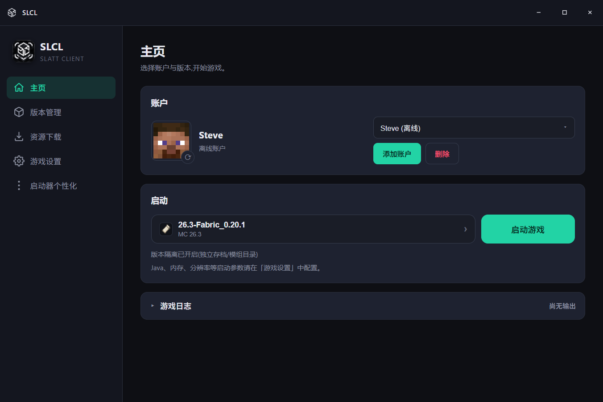
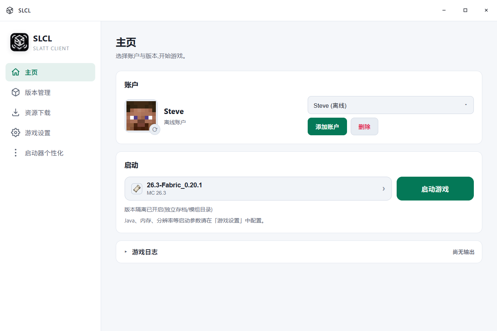
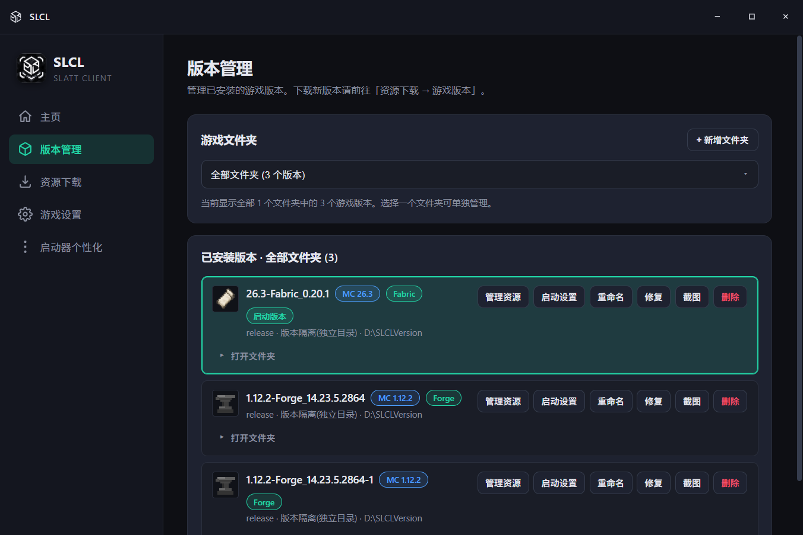
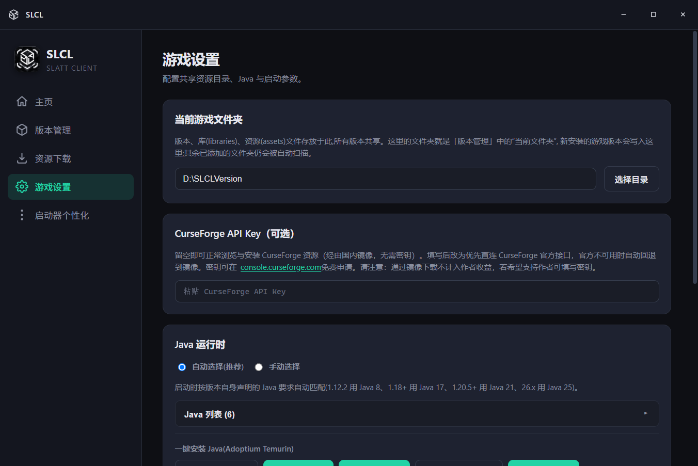
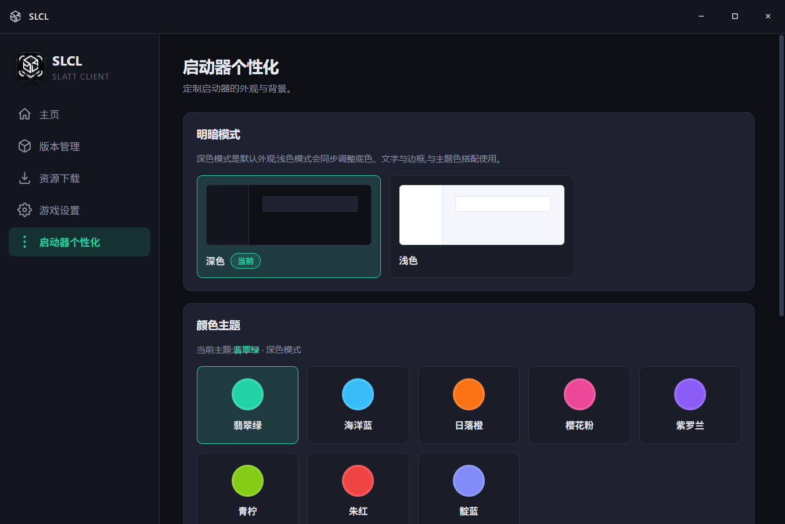
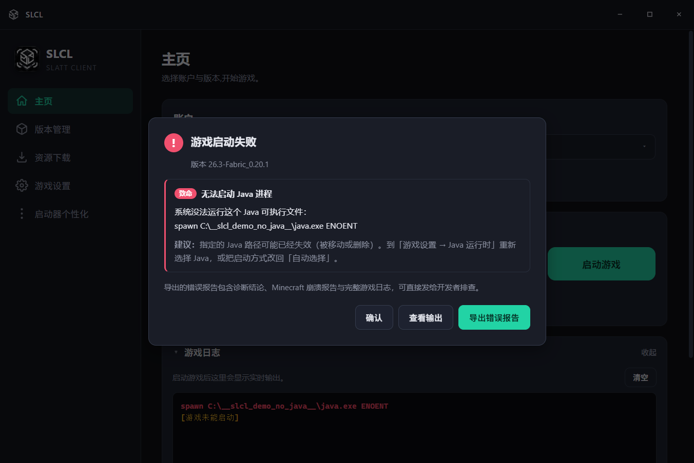

# SLCL · SLATT Client

启动器官网：https://slatt.cn/slcl

一个用 Electron + React + TypeScript 写的 **Minecraft Java 版启动器**，面向 Windows 桌面。

支持离线 / 微软正版 / LittleSkin 登录，多版本管理与安装（原版 + Fabric / Forge / NeoForge），
Modrinth 与 CurseForge 双源资源下载与整合包安装，以及启动失败时的崩溃诊断。



---

## 下载

到 [Releases](../../releases/latest) 页面下载 Windows 安装程序：

| 文件 | 说明 |
|---|---|
| `SLCL Setup <version>.exe` | Windows 安装程序（x64） |
| `SHA256SUMS.txt` | 文件校验值 |

首次运行若遇到 SmartScreen「已保护你的电脑」提示，是因为未购买代码签名证书，
点击「更多信息 → 仍要运行」即可。版本更新日志见 [`docs/releases/`](docs/releases/)。

---

## 功能

### 账户

- **离线登录** —— 填个名字即可，适合单机
- **Microsoft 正版登录** —— 设备码流程，登录后显示正版皮肤
- **LittleSkin 外置登录** —— 自动注入 authlib-injector，支持第三方皮肤站

### 版本管理

- 安装**原版**，或叠加 **Fabric / Forge / NeoForge**（含 1.12.2 legacy Forge）
- **多个游戏文件夹**：自动扫描、新增、切换「当前文件夹」
- **版本隔离**：每个版本独立的存档 / 模组 / 配置目录
- 7 种像素风格版本图标，一眼区分原版 / Forge / Fabric / 快照 / 远古版
- 排序按游戏版本新 → 旧，同版本内按加载器优先级
- 重命名、修复（补全缺失的库与 natives）、删除、打开文件夹、查看截图
- 每个版本可单独设置内存与 Java，不受全局设置影响

### 资源下载

- **Modrinth + CurseForge 双源**，可随时切换
- 5 类内容：模组、资源包、光影、数据包、整合包
- 按加载器 / 游戏版本过滤，分页浏览热门推荐
- **整合包一键安装**：` .mrpack` 与 CurseForge `.zip` 都能装，自动创建对应游戏版本与加载器
- 已安装内容支持图标预览、启用 / 停用、删除
- **CurseForge 无需 API Key**（默认走国内镜像）；想走官方接口可在设置里填 Key

### Java

- 自动检测系统里已安装的 Java
- 按版本实际要求匹配：1.12.2 → Java 8，1.18+ → 17，1.21+ → 21，26.x → 25
- Adoptium Temurin **一键安装**任意主版本，支持取消与进度显示
- 支持手动导入任意 Java 路径

### 启动与诊断

- 主页直接选择启动版本，实时游戏日志（默认折叠）
- 内存 / 分辨率 / 全屏 / 额外 JVM 参数均可配置
- **崩溃诊断**：启动失败或崩溃时弹窗分析原因，覆盖缺少前置、模组版本不匹配、
  模组冲突、Java 版本过低、内存不足、Mixin 失败、显卡驱动异常、文件损坏等
- 弹窗提供三个操作：**确认**、**查看输出**（打开真实游戏日志）、
  **导出错误报告**（诊断结论 + 崩溃报告 + 完整日志，可直接发给开发者）

### 界面

- 无边框自定义标题栏，窗口按钮跟随主题
- **8 套配色 × 深浅双模式**：翡翠绿、海洋蓝、日落橙、樱花粉、紫罗兰、青柠、朱红、靛蓝
- 自定义背景图 + 透明度
- 开屏动画、页面切换与弹窗动效

### 网络

- **BMCLAPI** 镜像加速 Mojang / Forge / Fabric / NeoForge 下载
- **MCIM** 镜像加速 Modrinth / CurseForge 元数据与文件
- 下载带停顿检测、大文件优先、字节级进度；镜像失败自动回退官方源

---

## 截图

| 主页（深色） | 主页（浅色） |
|---|---|
|  |  |

| 版本管理 | 资源下载 |
|---|---|
|  |  |

| 游戏设置 | 启动器个性化 |
|---|---|
|  |  |

**崩溃诊断弹窗** —— 自动分析失败原因，并可导出报告：



---

## 技术栈

| 层 | 选型 |
|---|---|
| 运行时 | Electron 45 |
| 界面 | React 19 + TypeScript |
| 构建 | electron-vite 6 / Vite 8 |
| 打包 | electron-builder 26（NSIS 安装程序） |
| Minecraft 核心 | `@xmcl/core`、`@xmcl/user`、`@xmcl/unzip` |
| 配置存储 | `electron-store` |

---

## 快速开始

### 环境要求

- **Node.js 20+**（推荐 22 LTS）
- **Windows**（打包目标为 NSIS；开发时可跨平台运行，但部分路径逻辑面向 Windows）

### 安装依赖

```bash
npm install
```

`postinstall` 会自动执行 `scripts/patch-xmcl.cjs`，修复 `@xmcl/unzip` 上游发布时
`main` 字段指向 `.ts` 源码导致运行时无法 `require` 的问题。**不要跳过这个脚本。**

### 开发

```bash
npm run dev
```

### 类型检查 / 构建

```bash
npm run typecheck   # tsc，主进程 + 渲染进程
npm run build       # 产出到 out/
npm run dist        # 构建 + 打包 Windows NSIS 安装程序到 dist/
```

### 打包产物

```
dist/SLCL Setup <version>.exe      # 安装程序
dist/win-unpacked/SLCL.exe         # 免安装版
```

安装程序使用自定义 NSIS 脚本（`build/installer.nsh`）：

- 欢迎页 / 完成页 / 卸载页使用 SLCL 品牌文案与侧边插图
- 若安装路径选到盘符根目录（如 `D:\`），会自动改为 `D:\SLCL`，不会把文件散落到根目录
- 卸载时可勾选是否同时删除 `%APPDATA%\slcl` 缓存，并在真正卸载前二次确认

---

## 目录结构

```
SLCL/
├─ build/                      # 打包资源
│  ├─ icon.ico / icon.png      # 应用与安装程序图标
│  ├─ fabric@512.png           # Fabric 版本图标源文件
│  ├─ installer.nsh            # 自定义 NSIS 安装脚本
│  └─ installerSidebar.bmp     # 安装向导侧边插图
├─ docs/screenshots/           # README 截图
├─ scripts/
│  └─ patch-xmcl.cjs           # postinstall：修 @xmcl/unzip 的 main 字段
├─ src/
│  ├─ main/                    # 主进程
│  │  ├─ auth/                 # 离线 / 微软 / LittleSkin 登录与皮肤
│  │  ├─ download/             # BMCLAPI 镜像路由、带停顿检测的下载器
│  │  ├─ ipc/                  # 全部 IPC handler
│  │  ├─ java/                 # Java 检测与 Adoptium 安装
│  │  ├─ launch/               # 启动、崩溃诊断、authlib-injector
│  │  ├─ resources/            # Modrinth / CurseForge 与镜像回退
│  │  ├─ settings/             # electron-store 配置与迁移
│  │  ├─ versions/             # 版本扫描 / 安装 / 排序 / 修复
│  │  ├─ ua.ts                 # 统一 User-Agent
│  │  └─ index.ts              # 窗口创建与生命周期
│  ├─ preload/                 # contextBridge 暴露的 API
│  ├─ renderer/                # React 界面
│  │  ├─ src/components/       # Select / Toast / Confirm / Crash / Splash …
│  │  ├─ src/pages/            # 主页 / 版本 / 资源 / 设置 / 个性化
│  │  └─ src/styles/global.css # 主题变量与全部样式
│  └─ shared/                  # 主/渲染共享的类型、IPC 通道、API 契约
├─ electron-builder.yml
├─ electron.vite.config.ts
└─ package.json
```

---

## 数据与配置

| 内容 | 位置 |
|---|---|
| 启动器配置 | `%APPDATA%\slcl\config.json` |
| 皮肤缓存 | `%APPDATA%\slcl\skins\` |
| SLCL 安装的 Java | `%APPDATA%\slcl\java\` |
| 默认游戏目录 | `%APPDATA%\.minecraft`（与官方启动器相同，会自动识别已有版本） |

配置里**不保存** Microsoft 访问令牌 —— 令牌只存在内存中，重启后需重新登录。

---

## 镜像与合规说明

- **BMCLAPI**（[bmclapidoc.bangbang93.com](https://bmclapidoc.bangbang93.com/)）：Mojang / Forge / Fabric / NeoForge 下载镜像，官方源始终作为回退保留。
- **MCIM**（[mcimirror.top](https://www.mcimirror.top/)）：Modrinth / CurseForge 元数据与文件镜像。SLCL 已按 MCIM 要求在
  [启动器登记](https://github.com/mcmod-info-mirror/mcim-rust-api/issues/12) 注册，所有请求统一发送 `SLCL/{version}` 作为 User-Agent。
- 通过镜像下载**不计入模组作者收益**。若希望支持作者，可在「游戏设置」填写自己的 CurseForge API Key，走官方接口。
- 镜像均为第三方公益服务，稳定性不受本项目控制；两者失败时都会自动回退到官方源。

---

## 第三方资源声明

- 本项目**不包含**任何 Minecraft 游戏文件，首次启动时由使用者本机下载。
- `src/renderer/public/fabric.png` 与 `build/fabric@512.png` 为 **Fabric** 项目标识，版权归 FabricMC 所有，仅用于在界面上标识 Fabric 加载器。
- Minecraft 是 Mojang Studios / Microsoft 的商标。本项目与 Mojang、Microsoft 无关联，未获其认可或授权。

---

## 许可证

[MIT](LICENSE) © 2026 SLATT团队-SKi斯基

---

## 致谢

- [@xmcl](https://github.com/Voxelum/x-minecraft-launcher) —— Minecraft 启动核心
- [BMCLAPI](https://bmclapidoc.bangbang93.com/) —— 国内下载镜像
- [MCIM](https://www.mcimirror.top/) —— Modrinth / CurseForge 镜像
- [Modrinth](https://modrinth.com/) 与 [CurseForge](https://www.curseforge.com/) —— 内容平台
- [Adoptium](https://adoptium.net/) —— Java 运行时
